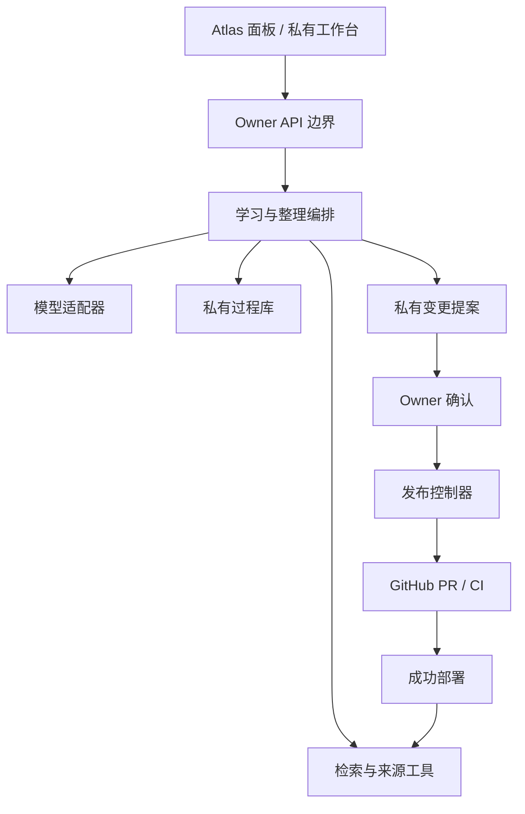

# Atlas Personal Agent — Architecture v0.1

状态：架构基线与本地契约检查已实现；尚无在线 Agent、身份认证、模型调用或云端数据库。本文不授权自动合并或部署当前开发分支。

## 1. 目标与边界

用户直接在 Atlas 学习和解决问题。Agent 自动检索已有知识、解释缺失内容、积累候选、去重查证、整理标准文档及归属，提供具体变更让用户确认，然后执行获批的发布范围。用户不需要逐步指挥每一次整理操作。

第一版同时服务**智能检索与引导、知识整理、知识库完善**。仅允许一个 Owner 使用；公开知识网站继续独立于 Personal OS。多人注册、共享记忆、多租户和多 Agent 编排不在本期范围内。

`ARCHITECTURE.md` 继续定义知识身份、六阶段、三条 Loop、九个 Domain 和四个 Context。本文定义 Agent 的边界与执行原则；`CONTENT_WORKFLOW.md` 定义知识入库流程；JSON Schema 定义提案结构。发生冲突时先修正规范，不能让模型自行选择规则。

## 2. 从需求推导的设计原则

| 原则 | 来自哪项需求 | 实施约束 | 验收证据 |
| --- | --- | --- | --- |
| P1 单一正式知识源 | 手动 GitHub 更新与 Agent 更新都有效 | Markdown 和现有元数据是正式知识；私有库保存过程；索引可重建 | 手动增删改后重新部署，Agent 读取新快照 |
| P2 自动准备，具体确认 | 用户专注学习，其他工作自动完成 | 检索、候选提炼、去重、整理自动；公开前确认具体版本 | 不逐次发整理指令也产生草稿；未批准不创建公共 PR |
| P3 确定性权限边界 | 只有本人能操作 | 每个私有 API 验证 Owner；模型不能授予权限、批准自己或取得密钥 | 匿名、错误身份、伪造/过期凭证均失败 |
| P4 保留知识身份 | 避免知识分散和链接失效 | 一 Topic 一 canonical location，一文章一 Primary Domain；视图只引用 | 原校验器、历史链接和锚点回归通过 |
| P5 版本参与决策 | 其他工具和本人也会修改仓库 | 读取、审批和执行都绑定内容与规则版本；禁止覆盖并发更新 | main 或规则变化使旧批准失效 |
| P6 学习过程默认私有 | 私人记忆、工作资料与公开知识不同 | 聊天/候选/草稿留私有；公开 PR 之前完成公开范围审阅 | 未确认材料不出现在仓库、公共缓存或日志 |
| P7 记忆有来源、有边界 | 长对话不能带偏事实或权限 | 摘要是派生上下文；依赖版本变化后重检索；不从 memory 推导权限 | 旧摘要不覆盖新原文；会话可导出/删除 |
| P8 网站交互连续 | 阅读和 Agent 联动顺畅 | 面板独立于文章路由；类型化导航动作；服务故障不阻断阅读 | 换文章保留会话；离线仍可用原网站 |
| P9 失败可恢复且诚实 | 一次确认后自动处理后续流程 | 持久任务、幂等键、明确失败阶段；合并不等于上线 | 重试不重复建 PR；部署失败不显示成功 |
| P10 规范可演进 | 网站架构后续会调整 | 分类从仓库解析；规则有摘要；旧提案重新校验 | 改规则后旧批准拒绝，新提案适配当前规范 |
| P11 保持简单 | 个人使用、低维护 | 单 Worker、一个私有 DB、一个模型适配器、一个编排器；先完整小索引 | 不引入微服务、多租户框架或强制向量数据库 |

这些原则约束实现和验收，不只作为提示词。提示词用于引导模型；权限、并发、审批、语义写入范围与状态转换由服务端代码处理。

## 3. 部署与模块边界

目标部署：现有 GitHub Pages 保持公开阅读；独立 Cloudflare Worker 提供私有 API/工作台；Access 限制 Owner；D1 保存私人过程；持久任务负责同步和发布。尚未创建这些资源。

| 模块 | 负责 | 不拥有的能力 |
| --- | --- | --- |
| Atlas 面板 | 对话、引用、导航、查看差异、确认 | 密钥、身份判定、直接写 GitHub |
| Owner API | JWT 验签/issuer/audience/有效期、唯一 Owner、CSRF/Origin、私有响应 | 从客户端邮箱或聊天内容授予权限 |
| 编排器 | 检索、解释、提炼、去重、草稿、调用受限工具 | 绕过审批或执行任意 shell/模型代码 |
| 模型适配器 | 统一请求、结构化结果、取消/超时、用量 | 发布凭据、审批接口、任意网络/仓库权限 |
| 检索/同步 | 全量章节与关系快照、来源版本、可点击定位 | 私自更改正式知识 |
| 提案校验器 | schema、现有知识校验、语义写入范围、摘要与版本 | 判定技术内容必然正确或可公开 |
| 发布控制器 | 只执行已批准的不可变变更；幂等 PR/检查/发布 | 让模型决定要写哪些额外文件 |
| D1 | 私有过程、证据、不可变提案版本、审批、任务 | 第二套可独立编辑的正式百科 |

外部网页、仓库正文、检索片段和会话摘要均作为资料，不作为系统指令。工具参数须通过白名单和 schema；模型返回的代码不执行。来源抓取另设协议/域名策略、超时和容量限制，不能访问私有基础设施地址。

## 4. 三种数据与三个版本

| 数据 | 权威位置 | 更新方式 |
| --- | --- | --- |
| 正式文章、Topic、分类、关系 | GitHub Markdown + 元数据 | 正常开发或获批知识 PR |
| 会话、候选、草稿、审批、任务 | 私有 D1 | 经过身份校验的服务操作 |
| 检索正文、章节、别名、图谱 | 可重建快照 | 从验证通过的构建产物生成 |

| 版本 | 含义 | 使用场景 |
| --- | --- | --- |
| `repo_head` | main 最新提交 | 写入基线、并发校验 |
| `published_revision` | 实际成功部署的提交 | 网页可访问的正式知识 |
| `index_revision` | 当前激活索引提交 | 回答与引用依据 |

默认回答使用与线上部署一致的快照；main 领先时显示待发布。索引落后时显示滞后，必要时从验证过的线上快照直接读取；不得无提示地声称已读最新版本。历史消息保留当时引用，不改写为新版本。

每次新问题、生成提案、确认与执行前检查版本。所有成功 main 部署触发同步，与提交者无关；通知只是信号，同步服务从固定仓库/可信构建来源校验实际部署和摘要。新快照完整校验后原子激活；失败保留旧快照；删除/重命名不能留下旧索引。首期内容规模允许完整重建，向量检索以后按实际效果决定。

`contract_digest` 是 `agent/proposals.py` 列出的规范/分类文件的逐文件 SHA-256 清单摘要。当前保守地把元数据整体纳入：引用变化也会要求重验。站点展示版本、提案 schema 版本、数据库 migration 版本各自独立。

## 5. Owner、审批与写入

Owner 邮箱/subject、Access audience、GitHub App 密钥和模型密钥全部通过私有配置提供；公开源码不保存真实邮箱。API 验证签名、issuer、audience、有效期及配置 Owner；不信任浏览器上送的 `owner_id`。预览域名、WebSocket/流式响应和后台任务入口也必须保护。

同站点私有 API 子域名是优先验证方案，先测试顶层登录、Cookie、CORS/OPTIONS、CSRF 和浏览器限制。CORS 不能代替鉴权。若内嵌登录受限，使用完整私有工作台回退，不降低鉴权要求或自行迁移主站 DNS。

模型只准备提案。Owner API 生成审批记录，绑定 `proposal_id + proposal_version + patch_digest + base_commit + contract_digest + release_scope`，记录有效期和撤销状态。审批页面显示完整正文差异、归属、来源和公开范围。公开仓库的草稿 PR 同样公开，因此确认必须发生在创建 PR 之前。

任何 base/规则/正文/归属/关系/公开范围变化，都创建新版本并使旧批准不能继续执行。首期不自动重用批准做 rebase；无冲突也须重新校验并确认新基线。此保守规则减少并发歧义，可在有证据后优化。

`open_pr` 只授权创建 PR；`merge_and_deploy` 是未来一次确认完成发布的目标范围，须同时满足真实 GitHub 保护规则和 CI。当前开发不启用自动合并。rulesets 查询为空不能证明不存在传统分支保护；后者此前查询受集成权限限制，仍待验证。

普通入库允许内容 Markdown 与必要元数据，禁止前端、工作流、Secrets、仓库设置和分类定义的修改。路径白名单只是一层检查；实际执行前必须比较解析后的语义，确保只添加合法引用、维持单一归属和历史身份。当前 schema/helpers 尚不是完整发布安全边界。

## 6. 网站联动与记忆

- 默认关闭的面板；桌面可展开工作台，移动端全屏。会话存在路由容器之外。
- 阅读上下文只传 Article/Topic/anchor/来源视图及用户主动发送的选中文本；不把问题或认证信息放进 URL。
- 导航动作只允许解析后的现有 ID 和锚点。普通回答给引用；明确要求打开时再导航。禁止模型 JavaScript/任意 DOM 指令。
- 摘要保存依赖内容摘要和更新时间；服务组装有限上下文时重新检索原文。长期偏好需明确范围，不能任意把工作材料升格为长期记忆。
- 整理在后台增量进行，以安静的候选/待确认卡片呈现。追问修订私人草稿，不假设用户结束学习，也不每轮强制创建文章。

## 7. 实施顺序与退出条件

| 顺序 | 交付物 | 本轮状态 / 进入下一步的条件 |
| --- | --- | --- |
| A 架构与数据基础 | 本文、入库规范、提案 schema、审批摘要检查、SQL migration、回归检查 | 本轮交付；仅本地验证，不等同于在线服务 |
| B 流程与交互验证 | 面板/工作台样稿；模拟模型驱动检索→学习→候选→差异→确认；语义变更校验器 | 不用真实密钥；验证不逐次指挥也能完成流程、失败/并发/导航恢复 |
| C 私有运行环境 | Owner 认证、D1、可信快照同步、持久任务、一个模型适配器 | 验证账号、API/预算、域名方案和私有存储恢复；通过真实鉴权负例 |
| D 发布集成 | 单仓库 GitHub App、获批 PR、CI/部署/同步跟踪 | 验证分支保护与幂等性；用户批准具体部署后上线 |

这是开发验证顺序，不把三项产品能力拆成只读版本长期交付。B 阶段即用模拟适配器验证全部学习与入库流程。

## 8. 第一版整体验收清单

1. 非 Owner、无效凭证、跨站请求不能读取私人消息或发起写操作。
2. 既有知识可定位到 canonical 文章/章节，跨路由保持会话，深浅主题/键盘/移动端可用。
3. 未收录的问题可继续讲解，并区分站内依据、外部来源、个人经验和未核实推断。
4. 自动提炼去重、整理候选；低成熟度保留私有，不创建空文章。
5. 未批准无公共 PR；内容或规则变化使批准失效；发布只执行批准的文件与范围。
6. 手动 GitHub 增改删/重命名后成功部署，快照同步；旧摘要不覆盖新正文。
7. 合并、上线、索引激活分别显示；同步/部署失败可恢复，无重复 PR。
8. 数据可导出/删除；迁移、外键、备份恢复经过真实环境演练。
9. 原有阅读、搜索、知识图谱、历史链接和离线文件在 Agent 故障时正常。

本轮仅验证结构、摘要/批准匹配与 SQLite 数据约束。以上在线、身份、语义写入和恢复验收在相应实现阶段完成；不以 schema 校验替代它们。
